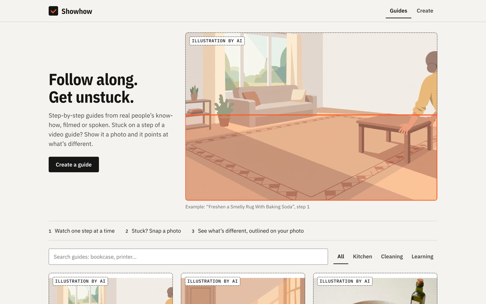
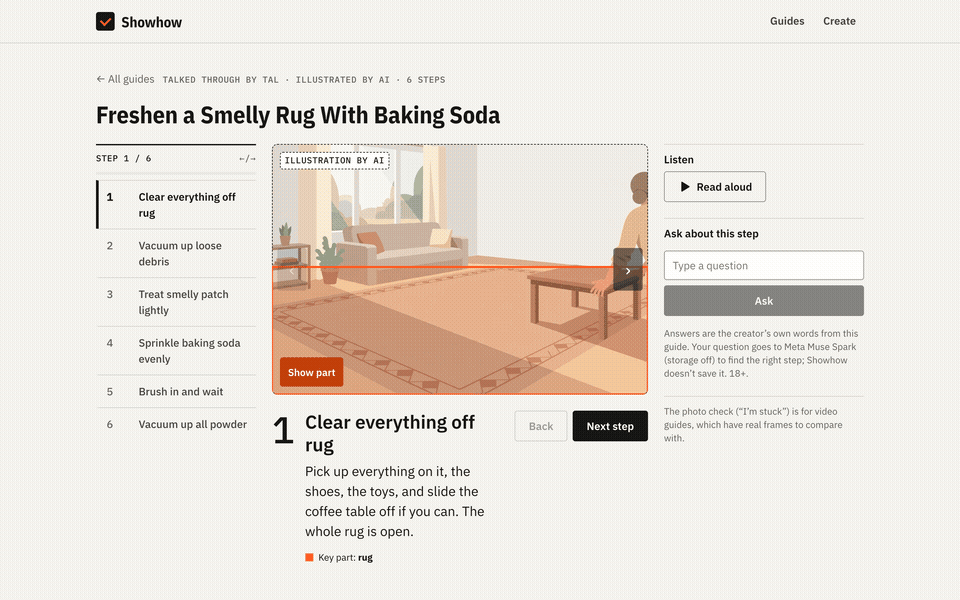
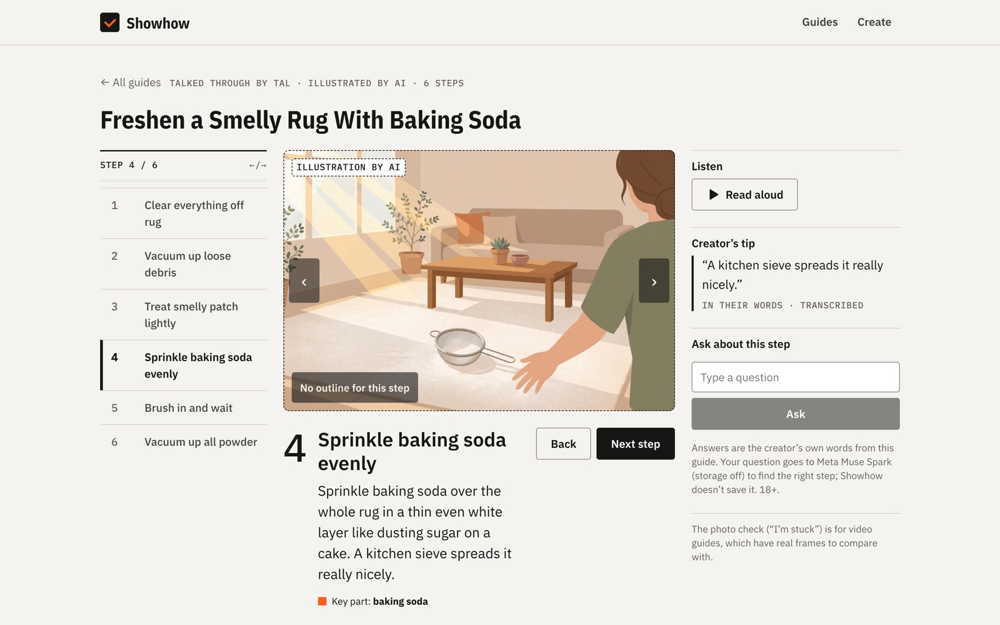
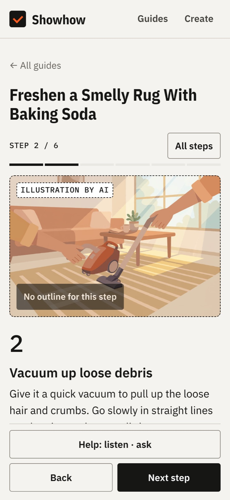
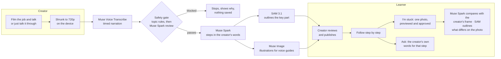
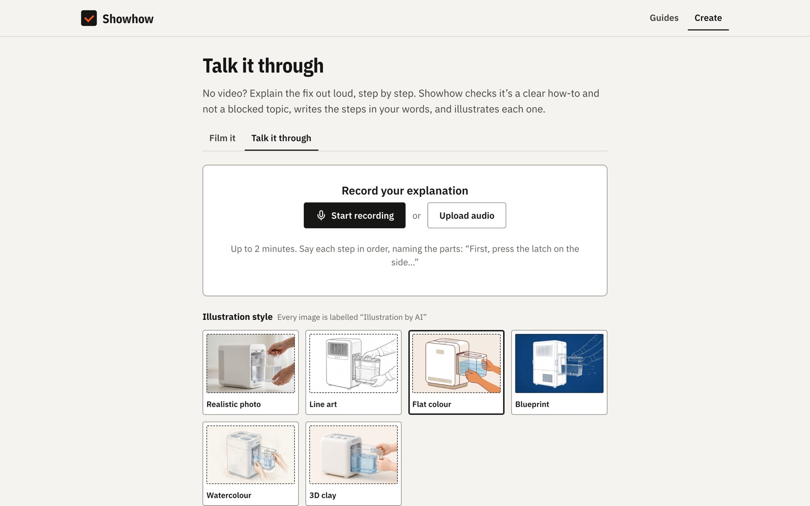

# Showhow

**YouTube can't see you're stuck. This can.**

Showhow turns a creator's narrated how-to video, or just a spoken explanation, into a step-by-step guide that can check your work. Follow along one step at a time; only when you're stuck, send one photo. Meta's models compare it with the creator's real frame for that step and outline what looks different on *your* photo.

**Live:** https://goodfix-alpha.vercel.app · **Demo video:** *link added at submission* · Built for the Meta Global AI Developer Hackathon (2026-10-27 → 2026-11-04)

Watching guides, "I'm stuck" and the step chat are open to everyone (18+). Creating a guide uses the demo access code **`Meta2026`**, already filled in on the Create page ([judge link](https://goodfix-alpha.vercel.app/?code=Meta2026#/create)); daily caps protect the credits.

<p align="center">
  
</p>

## A guide, one step at a time

Steps on the left, the step's picture or the creator's own looping clip in the middle, help on the right: read aloud, the creator's tip in their own words, "I'm stuck" and "Ask about this step". Arrow keys change steps.

<p align="center">
  
</p>

<table>
  <tr>
    <td width="62%"></td>
    <td width="38%"></td>
  </tr>
  <tr>
    <td align="center">Desktop workbench</td>
    <td align="center">Phone: one column, sticky Back / Next</td>
  </tr>
</table>

<sub>The example guide above was built on the live site from a test narration; its pictures are Muse Image illustrations and are always labelled "Illustration by AI".</sub>

## How it works



| Step | What happens | Meta model |
|---|---|---|
| 1. Creator films and talks | Instant checks on the device (length, size, sound). The video is shrunk to 720p **in the browser**; the original never leaves the device | — |
| 2. Words become text | Narration is transcribed into timed turns | Muse Voice Transcribe |
| 3. Safety gate | Hard topic rules (our code), then a model review; video frames are checked too. Fails closed and says which check stopped | Muse Spark |
| 4. Steps in the creator's own words | Split, ordered and titled; never adds advice the creator didn't give. Creator reviews and edits before publishing | Muse Spark |
| 5. Key part outlined | One still per step; the part the creator talks about is outlined only where the model actually found it | SAM 3.1 |
| 6. Learner is stuck | One photo, previewed and approved before sending, compared with the creator's real frame → `match`, `differs` or `unclear`; what differs is outlined on the learner's photo | Muse Spark + SAM 3.1 |
| 7. Ask about this step | A typed question; the model only picks which steps answer it, and the learner sees the **creator's own words** quoted | Muse Spark |
| Voice guides | No video? Talk it through. Spark writes a picture brief per step; Muse Image draws it (one object stays the same, a routine gets its own scenes); SAM outlines the key part; steps are read aloud | Muse Spark, Muse Image, SAM 3.1, Wit.ai TTS |

<p align="center">
  
</p>

## Trust rules

- Learner photos and questions are never stored or logged; every Meta call uses `store: false`.
- Nothing leaves the device before the creator presses the button and agrees; nothing is saved unless every check passes.
- Outlines are drawn only where SAM 3.1 returned one. No match → no outline, said plainly.
- AI images are always labelled and never used as evidence. Model failures show an honest message and a retry, never a made-up result.
- The app never calls a guide "verified" or "safe". 18+ only. Fixed prompts, allowlisted models, server-only keys, daily caps.

## Built during the hackathon (2026-10-27 → 2026-11-04)

All of Showhow is new work from this window. The first Showhow commit is `9aa8e5e` (2026-10-30); `git log --since=2026-10-27 -- apps/showhow` lists every change.

- 2026-10-30: idea, spec and plan; React app; SAM/verdict parsers; live Meta API spikes
- 2026-10-31: Supabase schema with row-level security and usage caps; voice guides spec; image consistency via anchored edits
- 2026-11-01: full create pipeline (upload, transcribe, steps, outlines, publish), "I'm stuck" check, voice guides with a two-layer safety gate, AI-enhanced stills, read-aloud, duplicate hints, streamed progress
- 2026-11-02: "Workshop manual" UI, 3-column guide workbench, "Ask about this step", red-team fixes, production deploy on Vercel with a live failure drill
- 2026-11-03: instant on-device checks, "why it stopped" on blocked recordings, picture briefs + object/scene illustration modes with SAM outlines, judge-facing README

Evidence for every claim (what ran, when, and the result) is in [`apps/showhow/docs/HACKATHON-LOG.md`](apps/showhow/docs/HACKATHON-LOG.md). **Not part of this entry:** [`archive/vault-native/`](archive/vault-native/), an earlier, unrelated Expo app kept for history.

## Run it locally

```bash
cd apps/showhow
cp .env.example .env.local   # fill in your own keys
npm ci
npm run dev                  # UI + /api routes
npm test                     # vitest
```

Stack: React 19, TypeScript, Vite, plain CSS · Vercel functions (`apps/showhow/api/`) · Supabase Postgres + Storage · zod at every boundary. CI runs lint, typecheck, tests, build, a bundle scan for leaked secrets, `npm audit` and a full-history gitleaks scan.

## Docs

[Spec](apps/showhow/docs/PRD.md) · [Architecture](apps/showhow/docs/ARCHITECTURE.md) · [Decisions](apps/showhow/docs/DECISIONS.md) · [Tasks](apps/showhow/docs/TASKS.md) · [Deploy](apps/showhow/docs/DEPLOY.md) · [Demo script](apps/showhow/docs/DEMO-SCRIPT.md) · [UI mockup](apps/showhow/design/ui-v2-mockup.html) · [Status](STATUS.md)

## License

[MIT](LICENSE) © 2026 Muhammad Talha Ishtiaq
