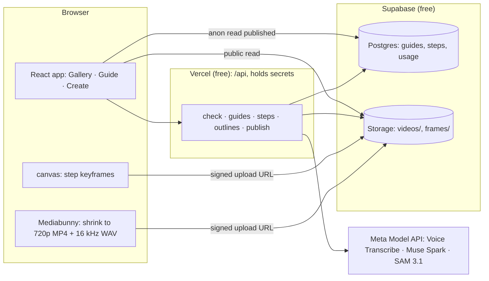

# Showhow Architecture

**Status:** 2026-10-30, for the hackathon build. Spec: [`PRD.md`](PRD.md).

## 1. System map



## 2. Data model (`supabase/schema.sql`)

```sql
guides(id uuid pk, slug text unique, title text, category text, creator_name text,
       status text check (status in ('draft','processing','ready','published','failed')),
       video_path text, duration_s real, error text, created_at timestamptz default now())
steps(id uuid pk, guide_id uuid fk, idx int, title text, instruction text,
      tip_quote text, tip_s real, start_s real, end_s real,
      key_part text, keyframe_path text, outline jsonb, unique(guide_id, idx))
usage(day date, kind text, count int, primary key(day, kind))   -- spend/rate caps
```

- `outline` = `{frame_w, frame_h, box:[x,y,w,h], polygon:[[x,y],…]}` in source-frame pixels, or `null`. The renderer scales it to the displayed size; it is never fabricated.
- RLS: anonymous users can `select` published guides and their steps only. All writes use the service role inside `/api`.
- Storage: `videos/{guide}/video.mp4`, `videos/{guide}/audio.wav` (WAV deleted after transcription), `frames/{guide}/{idx}.jpg`. Learner photos never touch Storage.

## 3. API routes

| Route | Auth | Does |
|---|---|---|
| `POST /api/check` | rate limit | `{guide, step, photo(base64 ≤1.5 MB), question?, mode:'stuck'|'where'}` → Spark verdict → SAM on learner photo if `differs` → gated result |
| `POST /api/guides` | access code | create draft, return signed upload URLs |
| `POST /api/guides/:id/steps` | access code | Transcribe WAV → Spark (video + transcript) → validated steps saved |
| `POST /api/guides/:id/outlines` | access code | SAM per keyframe with `key_part` → outlines saved |
| `POST /api/guides/:id/publish` | access code | save creator edits, set `published` |

Each route does one model stage so it stays within serverless time limits, and the browser drives the sequence and shows progress. A failure at any stage sets `status='failed'` with a plain `error` the creator sees, plus Retry.

## 4. Large video handling

- Input accepted: `video/*`, ≤2 GB, ≤5 min (checked from metadata before any work).
- Mediabunny converts on-device to H.264 720p, 30 fps max, target 1 Mbps, AAC audio. If the estimated size is over 48 MB it lowers the bitrate; if it still can't fit, it says so. The original never leaves the device.
- A WAV (16 kHz mono 16-bit) is extracted on-device for Voice Transcribe.
- Uploads go straight from the browser to Supabase Storage with signed URLs, so Vercel's ~4.5 MB request-body limit never applies to media.
- The viewer plays one MP4 per guide and loops `[start_s, end_s]` per step; there is no clip cutting.

## 5. Security and abuse controls

- **Secrets:** `META_API_KEY`, `SUPABASE_SERVICE_ROLE_KEY` and `CREATE_ACCESS_CODES` exist only in Vercel env and `.env.local` (git-ignored). The client gets only `VITE_SUPABASE_URL` and `VITE_SUPABASE_ANON_KEY`, which are public by design. CI fails if a built bundle contains a known secret pattern.
- **Meta Terms §10.1(i):** fixed prompts, an allowlisted model set, and no prompt passthrough, so the app is a single-purpose Integrated Product, not a gateway. Creating guides requires an access code. Going public needs the dated decision after the Discord answer.
- **Caps:** `usage` table counters. Per-day global caps on checks and guide builds; per-IP throttle on `/api/check`. When a cap is hit: a clear "daily demo limit reached" message.
- **Learner photos:** sent only after the user approves the preview; processed in memory; never stored or logged.
- **Logs:** route, status, timing and model id only; never bodies, photos, transcripts or keys.
- **Model output:** zod-parsed, rendered as text, outline coordinates bounds-checked against frame size.
- **Age:** 18+ checkbox on the first check and on creating a guide (Meta Terms).

## 6. Failure states

| Condition | User sees |
|---|---|
| Video too long/large or unreadable | Reason + supported limits, nothing uploaded |
| Shrink not supported in browser | "Use Chrome, Edge or Safari 16.4+" |
| Spark returns invalid steps | Retry, or "we couldn't split this video"; no partial guide published |
| SAM finds nothing | Step without outline; "Show part" disabled for that step |
| Check `unclear` | Ask for a closer, well-lit photo of the step |
| Meta timeout / 429 / 5xx | "The checker didn't answer. Try again"; never a fake verdict |
| Daily cap reached | Plain message; viewing guides still works |
