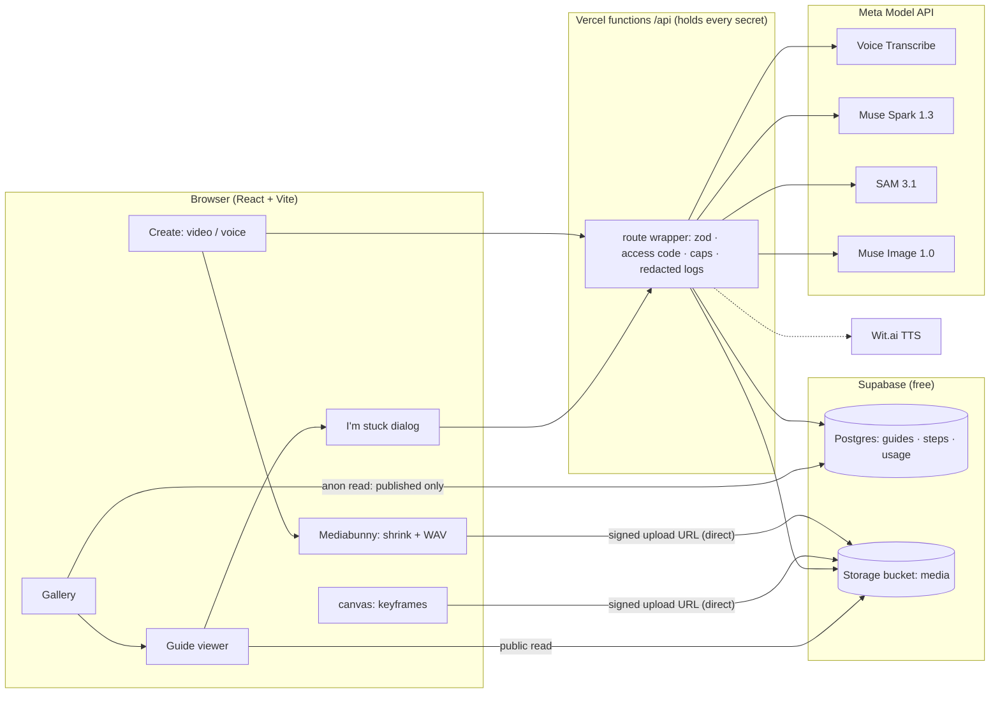
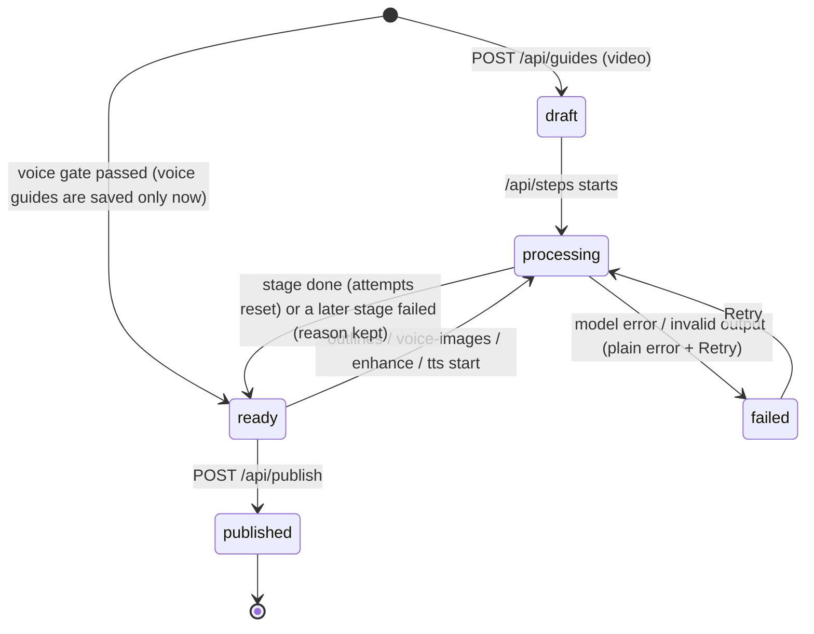
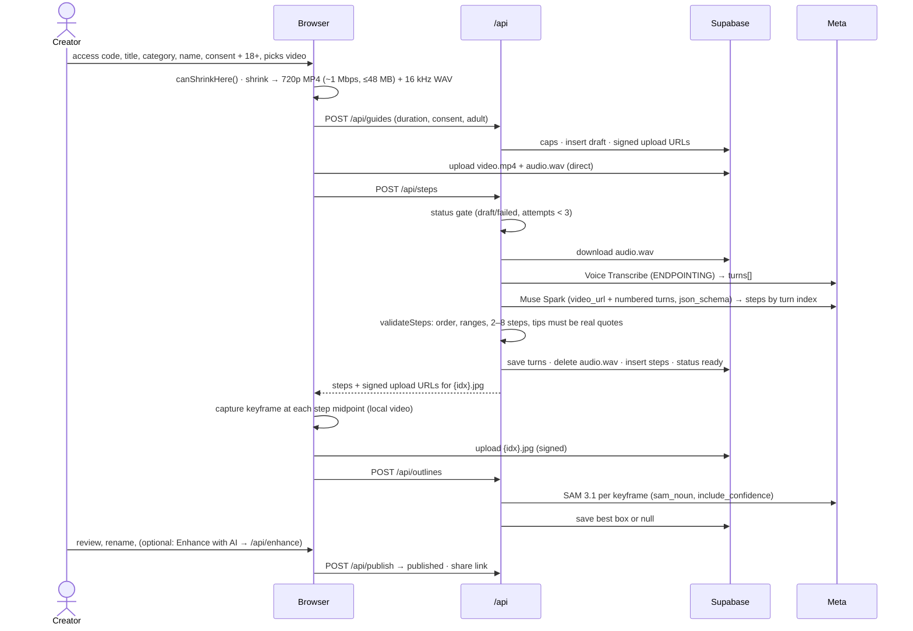
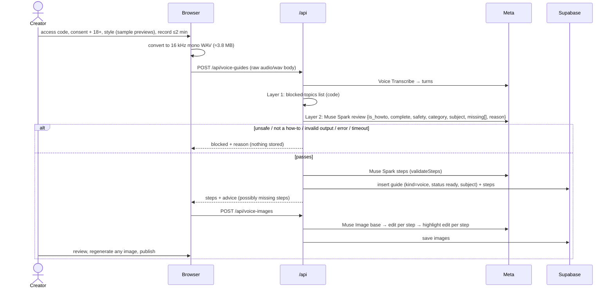
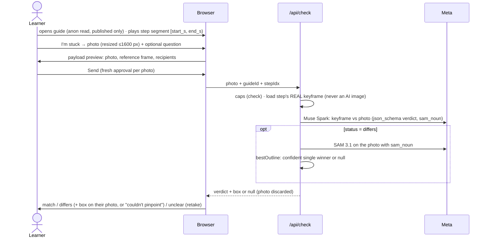

# Showhow Architecture

**Updated:** 2026-10-31 · **Spec:** [`PRD.md`](PRD.md) · **Plan:** [`TASKS.md`](TASKS.md) · **Decisions:** [`DECISIONS.md`](DECISIONS.md)

This document is the end-to-end technical picture: every component, every flow, every piece of data, and every safety rule. When it and the code disagree, fix one of them in the same commit.

---

## 1. What the system does

Three ways to **create** a guide, one way to **follow** it:

| Path | Creator gives | Guide shows | Task |
|---|---|---|---|
| **Video guide** | Narrated phone video (≤500 MB, ≤3 min) | Real clip segment per step + SAM box on the key part | T8–T11 |
| **Video guide, AI-enhanced** (optional checkbox) | Same video | Above, plus a cleaner "Enhanced by AI" image per step (original frame one tap away) | T18 |
| **Voice guide** | ≤2 min of speech, no video | AI illustration per step in a chosen style, highlight circle on the key part | T17 |
| **Learner** | Follows steps; optionally sends one photo when stuck | Verdict (match / differs / unclear) + box on *their* photo (video guides only) | T5–T6 |

Extras: read a step aloud (Wit.ai, T16), "Where am I?" (T7).



## 2. Components and responsibilities

| Component | Responsibility | Never does |
|---|---|---|
| **Browser app** (`src/`) | UI, routing (hash), on-device video shrink + WAV, keyframe capture, photo resize, consent screens, rendering outlines from stored geometry | Hold a secret; call Meta directly; draw geometry the server didn't return |
| **API** (`api/`, Vercel Node functions) | Validate, authorize (access code), enforce caps, call Meta, apply safety gates, write DB/Storage | Store learner photos or voice recordings; log bodies; pass user text through as a prompt |
| **Postgres** (Supabase) | Guides, steps, usage counters; row-level security | Expose drafts or counters to the public |
| **Storage** (Supabase bucket `media`) | Videos, keyframes, images, read-aloud MP3s | Accept uploads without a server-signed URL |
| **Meta Model API** | Transcribe, understand video/images, segment, generate images | Get media without consent; keep it (`store: false`) |
| **Wit.ai** | Text-to-speech for step text only (stretch) | Receive any user media |

**Stack:** React 19, TypeScript, Vite 8, plain CSS (prototype tokens), zod 4, Mediabunny 1.65, supabase-js 2, Vitest 5 + Testing Library. Node 22. Free tiers: Vercel Hobby, Supabase. Meta usage is paid from the $150 hackathon credits.

## 3. Repository layout

```
apps/showhow/
  api/                    one file per route (flat): guides, steps, outlines, publish, check,
    _lib/                 voice-guides, voice-images, enhance, health. "_lib" is not deployed as routes.
      read-aloud.ts       Wit.ai MP3 per step, called by publish (T16); wit.ts: the Wit call; jpeg.ts: frame size
      http.ts             route() wrapper, HttpError, access code, hashIp, redact
      caps.ts             daily caps via bump_usage (fail closed)
      db.ts               server-only Supabase client (service role)
      meta.ts             Meta calls with timeouts and store:false: transcribe, sparkJson (SAM in T5/T10, image in T17)
  src/
    app/                  views: GalleryView, GuideView, CreateView
    components/           Icon, OutlineOverlay, StuckDialog, …
    lib/                  pure logic shared by browser and API: types, geometry, sam, verdict,
                          steps, shrink, safety (T17), categories, data access
    fixtures/             TEST FIXTURE guides for offline UI work
  public/styles/          6 pre-generated Muse Image style samples (picker makes no model calls)
  supabase/schema.sql     tables, RLS, bump_usage, bucket (re-runnable)
  scripts/                apply-schema, check-db (RLS), scan-bundle (secrets), spike-check, spike-pipeline
  docs/                   PRD, ARCHITECTURE, TASKS, DECISIONS, HACKATHON-LOG
  design/                 HTML prototypes (showhow-prototype.html is the UI reference)
.github/workflows/ci.yml  lint, typecheck, test, build, bundle scan, audit, gitleaks (repo root)
```

## 4. Data model (`supabase/schema.sql`, applied 2026-10-31)

```sql
guides(id uuid pk, title text, category text, creator_name text,
       status text  -- draft | processing | ready | published | failed
       kind text    -- video | voice
       image_style text,            -- voice guides: realistic|lineart|flat|blueprint|watercolor|clay
       attempts int default 0,      -- model-stage runs; routes refuse after 3 (credit guard)
       turns jsonb,                 -- Transcribe turns; a retry reuses them instead of re-transcribing
       video_path text, duration_s real, error text, created_at timestamptz)
steps(id uuid pk, guide_id uuid fk on delete cascade, idx int, unique(guide_id, idx),
      title text, instruction text, tip_quote text,
      start_s real, end_s real check (end_s > start_s),   -- from Transcribe turn timestamps
      key_part text, sam_noun text,
      keyframe_path text,           -- real frame (video guides); the ONLY image checks compare against
      outline jsonb,                -- SAM box on the keyframe, or null
      image_path text,              -- AI image: voice illustration or T18 enhanced frame; highlight = same path + '-focus'
      audio_path text)              -- Wit.ai MP3 (T16)
usage(day date, kind text, count int, pk(day, kind))  -- caps; invisible to the public
bump_usage(kind, limit) → boolean   -- atomic increment; server key only
```

**Outline JSON** (camelCase, exactly as `src/lib/types.ts`): `{ frameW, frameH, box: [x, y, w, h], score }` in source-frame pixels. Built from SAM's xyxy box by `parseSamBoxes`, chosen by `bestOutline` (score ≥ 0.5 and ≥ 0.15 ahead of the runner-up, otherwise `null`). Masks are not stored yet; their mapping onto the frame is unverified.

**Guide status lifecycle:**



**Row-level security** (verified by `scripts/check-db.ts`, 11/11 on 2026-10-31): anonymous users can `select` guides with `status='published'` and their steps; nothing else. No insert/update/delete/RPC/upload for anon. All writes use the service role inside `/api`.

## 5. Storage layout (bucket `media`, public read, 50 MB/file, mp4/wav/jpeg/mpeg only)

| Path | Written by | Kept |
|---|---|---|
| `{guide}/video.mp4` | Browser via signed URL (T8) | Life of the guide |
| `{guide}/audio.wav` | Browser via signed URL (T8) | **Deleted** as soon as transcription succeeds (turns saved on the guide), or on the last failed attempt; otherwise by the 24 h cleanup |
| `{guide}/{idx}.jpg` | Browser via signed URLs returned by `/api/steps` (T9), the real keyframe | Life of the guide |
| `{guide}/{idx}-ai.jpg`, `{idx}-ai-focus.jpg` | Server (T17 illustration / T18 enhanced + highlight) | Life of the guide |
| `{guide}/{idx}.mp3` | Server (T16) | Life of the guide |

Never in Storage: learner photos, voice-guide recordings, blocked transcripts. Paths start with an unguessable UUID; drafts not published within 24 h are deleted by `scripts/cleanup-drafts.ts` (T14). Budget (free tier: 1 GB stored, 5 GB egress/month): ~23 MB per video guide → ~40 guides, ~200 full plays, hence the daily build cap.

## 6. API (`/api/<name>`, POST with JSON body unless noted)

Every route is built with `route()` (`api/_lib/http.ts`), which provides: POST only (405), body ≤4 MB (413), JSON + zod validation without echoing input (400), constant-time `x-access-code` check (401), typed `HttpError` statuses, a generic 500 that never leaks upstream text, and one log line with allow-listed fields only (`route, status, ms, model, requestId, code`).

| Route | Auth | Caps counter | Does | Task |
|---|---|---|---|---|
| `GET /api/health` | — | — | `{ok:true}` | T4 ✅ |
| `/api/guides` | access code | `build` | Validate title/category/name/duration/consent/18+ → insert draft → signed upload URLs for `video.mp4`, `audio.wav` | T8 |
| `/api/steps` `{guideId}` | access code | status gate | Only from `draft`/`failed` with `attempts < 3` (`claimGuide`). Transcribe once (save `turns`, delete WAV) → Spark (public `video_url` + numbered turns) → `validateSteps` → replace steps → `ready` → signed upload URLs for each `{idx}.jpg` + capture time. Measured live: 28.6 s | T9 ✅ |
| `/api/outlines` `{guideId}` | access code | status gate | From `ready`, video only. For each uploaded keyframe (`storage.list`): SAM with `sam_noun` (fallback: last word of `key_part`) → `bestOutline` → save `keyframe_path` + `outline`. Failure returns the guide to `ready` | T10 ✅ |
| `/api/publish` `{guideId, edits[{idx,title,instruction,dropAiImage?}]}` | access code | — | From `ready` only, once. Applies text edits (never times/geometry), optionally drops a rejected AI image, makes read-aloud MP3s from the **final** text (Wit.ai, best effort, T16), then `published`. Returns the share path + read-aloud results | T11 ✅ T16 ✅ |
| `/api/check` `{guideId, stepIdx, mode:'stuck', photo: base64 JPEG data URL ≤1.5 MB, question?≤300}` | — (public) | `check` | Published video guides only. Load the step's **real keyframe** (never `image_path`) → Spark verdict (`/v1/responses`, 60 s) → zod (invalid → 502) → SAM on the photo if `differs` (SAM failure → verdict without box) → gate. Model error/timeout → 504. Photo held in memory only | T5 ✅ |
| `/api/voice-guides` raw `audio/wav` body (≤4.2 MB ≈ 2 min; base64 JSON would exceed 4.5 MB); title/category/name/style/consent/adult as URI-encoded JSON in `x-meta` | access code | `build` | ✅ T17. Transcribe → safety gate (2 layers, fail closed) → steps → **only now** insert draft | T17 |
| `/api/voice-images` `{guideId}` | access code | status gate | ✅ T17. Base image from `subject` + style → per-step edit **of the base** → highlight edit → `{idx}-ai.jpg` + `-ai-focus.jpg` (a step that fails stays text-only; all fail → 502). Measured live: 44 s for 3 steps |
| `/api/enhance` `{guideId}` | access code | status gate | ✅ T18. Video only. Per real keyframe: Muse Image edit with `size = sizeLike(jpegSize(frame))` so the shape matches (no reframing) → highlight edit → `{idx}-ai.jpg` / `-ai-focus.jpg`; the real keyframe is never touched. Per-step failure tolerated; all fail → 502 (guide stays `ready`). Live: 27–32 s for 3 steps |

**Status gate (credit guard):** every model-stage route claims the guide atomically (`claimGuide`: right status, `attempts < 3`) and increments `attempts`; a successful stage resets it to 0 (`finishGuide`), so it counts consecutive failures of one stage. A failed later stage (outlines, enhance, voice-images) returns the guide to `ready` (its steps exist); only `/api/steps` sets `failed`. Retry from `failed` = calling the same route again. The browser drives multi-stage builds (guides → upload → steps → outlines → publish) so each function call stays within Vercel's limits and progress is visible. Long routes set `maxDuration` in `vercel.json` (T13).

## 7. End-to-end flows

### 7.1 Video guide (T8–T11)



### 7.2 Voice guide (T17): nothing is saved until the gate passes



### 7.3 Learner: follow and "I'm stuck" (T5–T6)



Voice guides hide "I'm stuck": they have no real reference frame.

## 8. Meta model calls (all verified live; request shapes in `api/_lib/meta.ts` and the spike scripts)

| Call | Endpoint · model | Input → output | Timeout | Verified |
|---|---|---|---|---|
| Transcribe | `POST /v1/asr/transcribe` · `muse-voice-transcribe-1.0`, `mode: ENDPOINTING` | multipart WAV (16 kHz mono, ≤32 MB, ≤10 min) → `turns[{startMs,endMs,transcript}]` | 90 s | 2026-10-30, 5.5 s |
| Steps | `POST /v1/responses` · `muse-spark-1.3`, `text.format: json_schema` | video (URL or data URL) + numbered turns → steps by turn index | 180 s | 2026-10-30, 15.6 s (data URL) |
| Verdict | `POST /v1/responses` · `muse-spark-1.3`, `text.format: json_schema` (one Spark endpoint everywhere; the spike used `/v1/chat/completions`) | 2 images + step text → `{status, differences[{part, sam_noun, note}], message}` | 60 s | 2026-10-30, 5–9.5 s |
| Voice review | `POST /v1/responses` · `muse-spark-1.3` | transcript → `{is_howto, complete, safety, category, missing[], reason}` | 60 s | T17 |
| Segment | `POST /v1/responses` · `sam-3.1`, `metadata.include_confidence: "true"` | image + one simple noun → `<\|box;x1;y1;x2;y2;w;h;c\|>` tokens | 60 s | 2026-10-30, ~1 s |
| Illustrate | `POST /v1/images/generations` · `muse-image-1.0` | prompt (+ style) → JPEG, $0.01 | 90 s | 2026-10-31, 10–21 s |
| Edit / highlight | `POST /v1/images/edits` · `muse-image-1.0`, `images[{image_url}]` | reference + instruction → JPEG, $0.01 | 90 s | 2026-10-31, 8–18 s |
| Speak (stretch) | `POST api.wit.ai/synthesize?v=20240304` | text → MP3 | 30 s | 2026-10-30, 3.1 s |

All Meta calls send `store: false` (Meta stores by default). Prompts are fixed in code (`steps.ts`, `verdict.ts`, `safety.ts`); user text only appears as clearly delimited data (the learner's question, the transcript), never as instructions. `sam_noun` is one simple common word ("tank", not "water tank"); multi-word or tiny targets returned no boxes in tests.

## 9. Trust and safety rules (where each is enforced)

| Rule | Enforced in |
|---|---|
| Instructions come from the creator's words; tips must be verbatim quotes | `stepsPrompt` + `validateSteps` (tested) |
| Step times come from Transcribe timestamps, not the model | `validateSteps` |
| Only SAM-returned, in-frame, confident, unambiguous boxes are drawn | `parseSamBoxes`, `bestOutline`, `isValidOutline` (tested) |
| Outline only for `differs`; malformed verdicts rejected | `parseVerdict`, `gateVerdict` (tested) |
| Checks compare against the **real keyframe** only | `/api/check` reads `keyframe_path` only (unit test in T18) |
| Voice guides: two-layer gate, fail closed, nothing saved before passing | `src/lib/safety.ts` + `/api/voice-guides` (T17, test-first) |
| AI images always labelled ("Illustration by AI" / "Enhanced by AI"); original frame one tap away for enhanced | Viewer components (T17/T18) |
| No "verified" or "safe" claims; badge: "AI-checked: clear, complete and within safety rules" | UI copy |
| No medical, electrical or safety advice in verdicts | `verdictPrompt`; voice blocked topics |
| Fixtures labelled `TEST FIXTURE`, never shown as live | `fixtures/`, viewer tags |

## 10. Security and privacy

**Environment variables**

| Variable | Where | Exposure |
|---|---|---|
| `VITE_SUPABASE_URL`, `VITE_SUPABASE_ANON_KEY` | Browser + server | Public by design (RLS protects data) |
| `META_API_KEY` | Server only | Secret |
| `SUPABASE_SERVICE_ROLE_KEY` | Server only | Secret (full DB access) |
| `CREATE_ACCESS_CODES` | Server only | Secret (comma-separated) |
| `WIT_TOKEN` | Server only | Secret |
| `IP_SALT` | Server only | Secret (salts per-IP hashes). Required on Vercel; locally a random per-process salt is used |
| `SUPABASE_ACCESS_TOKEN` | Local scripts only (`apply-schema`) | Secret; never deployed; revoke after setup |

Never `VITE_`-prefix a secret. `scripts/scan-bundle.ts` fails the build if any server value, `sb_secret_`/`sbp_` prefix, service_role JWT or server variable name reaches `dist/`; gitleaks scans the full Git history in CI.

**What is stored, where, for how long**

| Data | Stored? |
|---|---|
| Learner photo + question | Never. In memory for one request; sent to Meta with `store:false` |
| Voice-guide recording | Never. In memory; transcript kept only as step text if the gate passes |
| Creator video | Storage, public, life of the guide (creator consented) |
| Creator WAV | Storage until transcription, then deleted |
| IP address | Never raw; salted hash inside a daily `usage` counter key |
| Logs | Route, status, ms, model, request ID only |

**Abuse and cost:** daily caps (`check`: 300 total / 40 per IP; `build`: 20 total / 6 per IP), counted in Postgres so they hold across serverless instances, failing closed. Guide creation needs an access code. Meta documents no spend-limit control, so these caps are the guaranteed limit.

**Meta Terms:** fixed prompts, allowlisted models, no prompt passthrough (an Integrated Product, not a gateway, §10.1(i)); Standard models only, never Contributor mode; 18+ confirmation on create and on the first check. Public exposure needs a dated decision (Discord question pending).

## 11. Limits and budgets

| Item | Limit | Why |
|---|---|---|
| Creator video input | ≤500 MB, ≤3 min | Browser memory; free storage |
| Shrunk video | ~1 Mbps H.264 ≤720p, ≤48 MB | Supabase 50 MB/file |
| Voice recording | ≤2 min (≈3.8 MB WAV, sent as a raw body, not base64) | Fits one request under Vercel's ~4.5 MB body |
| Learner photo | ≤1600 px JPEG (~0.3–1.5 MB) | Fits one request; fast model calls |
| Steps per guide | 2–8 | `StepsSchema` |
| Vercel Hobby function | 300 s, 4.5 MB body, 2 GB RAM | Plan limits |
| Cost per guide (est.) | Transcribe + Spark + SAM ≈ cents; voice/enhance add ~$0.02 per step | $150 credits |

## 12. Failure states (user always sees an honest message; never a fabricated result)

| Condition | User sees |
|---|---|
| Video too long/large/unreadable | Reason + limits; nothing uploaded |
| Browser can't encode (`canShrinkHere` false) | "This browser can't prepare video. Use desktop Chrome or Edge." |
| Wrong access code | "That access code isn't valid." |
| Daily cap reached | "Today's demo limit is reached. Viewing guides still works." |
| Upload fails | Retry; drafts unpublished after 24 h are cleaned up |
| Same build stage failed 3 times | "This video couldn't be processed. Try a shorter, clearer clip." (credit guard) |
| Too little narration (<2 turns) | "We couldn't hear enough narration to build steps." |
| Spark returns invalid steps | Retry, or "we couldn't split this video"; nothing published |
| SAM: no / ambiguous match | No box; "Show part" disabled; check says "couldn't pinpoint it on your photo" |
| Check `unclear` | Ask for a closer, well-lit photo |
| Meta timeout / 429 / 5xx | "The checker didn't answer. Try again." Nothing guessed |
| Voice guide blocked | The reason (unsafe topic / not a how-to / unreadable check); nothing saved; Record again |
| Voice guide possibly missing a step | Built anyway; review shows "The AI thinks you may have skipped: …" |
| Muse Image fails or is policy-blocked | Step shows text only, "No illustration"; Regenerate |

## 13. Environments

| Env | How | Secrets |
|---|---|---|
| **Local** | `npm run dev`: Vite UI + a dev-only plugin serving `api/<name>.ts` with the same Request/Response handlers as Vercel; `.env.local` loaded server-side only | `.env.local` (git-ignored) |
| **CI** | GitHub Actions on push/PR: `npm ci` → lint → typecheck → test → build → bundle scan (fake canaries) → `npm audit`; separate full-history gitleaks job. Actions pinned to commit SHAs, read-only token | None (fake canaries only) |
| **Production** (T13, needs Talha's OK) | Vercel Hobby (static `dist/` + `api/` functions, `vercel.json` sets `maxDuration`); Supabase free; keep-alive through judging (2026-11-05 → 11-09) | Vercel env vars, server-only |

## 14. Test map

| Area | Tests |
|---|---|
| Geometry, SAM parsing, ambiguity rule | `src/lib/geometry.test.ts`, `sam.test.ts` |
| Verdict schema + gate | `src/lib/verdict.test.ts` |
| Step validation + grounding | `src/lib/steps.test.ts` |
| Shrink limits | `src/lib/shrink.test.ts` |
| Consent behaviour in the stuck dialog | `src/components/StuckDialog.test.tsx` |
| Route wrapper, access code, redaction, caps | `api/_lib/http.test.ts`, `caps.test.ts` |
| RLS on the live DB | `scripts/check-db.ts` (manual, logged) |
| Secrets in bundle / history | `scripts/scan-bundle.ts`, gitleaks (CI) |
| Model accuracy | `scripts/spike-check.ts` (staged photos), `spike-pipeline.ts` (real video), logged |
| `/api/guides`, `/api/steps`, `/api/outlines`, `/api/publish` (fake DB + mocked Meta) | `api/_lib/guides.test.ts` (5), `steps.test.ts` (7), `outlines.test.ts` (4), `publish.test.ts` (3) |
| `/api/check` (fake DB + mocked Meta) | `api/_lib/check.test.ts` (9): real-keyframe-only (T18 rule), differs + box, ambiguous → no box, unclear → no SAM, malformed → 502, timeout → 504, cap → 429 before any model call, refusals, input limits |
| Voice gate + routes | `src/lib/safety.test.ts` (25: 14 blocked phrasings, 6 everyday phrasings allowed, fail-closed review), `api/_lib/voice.test.ts` (14: nothing saved on any block, base-anchored edits, per-step failure, 415/413/400/401/429) |

## 15. Known risks and open questions

1. Muse Spark video limits (size/duration, frame sampling) are undocumented; the 3-min/48 MB cap is our guard. Spark fetching a Supabase public URL works (verified 2026-11-01).
2. SAM mask-to-frame mapping is undocumented; boxes only.
3. AI image content can be wrong even when consistent (e.g. tank still attached while filling); creator review + regenerate.
4. Check accuracy on real staged photos is unmeasured until T0.
5. Hosting terms: Discord answer pending; build stays behind access codes until then.
6. Unproven until logged (must not appear in the demo before then): Vercel `maxDuration` in production (local `/api/steps` took 28.6 s, well under 300 s); real-photo check accuracy. ~~Spark reading a Supabase public `video_url`~~ verified 2026-11-01.
