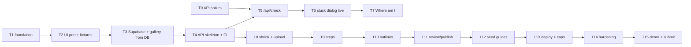

# Showhow Plan and Tasks

**Updated:** 2026-10-30 · **Deadline:** 2026-11-04 21:00 ET · Spec: [`PRD.md`](PRD.md) · Architecture: [`ARCHITECTURE.md`](ARCHITECTURE.md)

A task is `[x]` only when its **Verify** step has passed and is noted in `HACKATHON-LOG.md`. Each task is one `/build` run: test first where there's logic, then lint, typecheck, test and build, then commit.

**Talha's inputs (needed by the day shown):**
- [ ] D1: Meta API key with the $150 credits claimed and a spend limit set, put in `apps/showhow/.env.local` (never pasted in chat).
- [ ] D1: post the hosting question in Discord #office-hours.
- [ ] D2: free Supabase project + Vercel account.
- [ ] D3: film 3–4 seed videos (≤3 min, narrated, clear right/wrong steps).

## Dependency graph

## Day 1: 2026-10-31. Prove the risky parts, build the shell

- [ ] **T0 Meta API spikes** (script in `apps/showhow/scripts/spike.ts`, synthetic media only).
  - (a) Spark: two images + text → JSON verdict.
  - (b) SAM 3.1: text prompt on an image → record the mask/box format.
  - (c) Voice Transcribe: WAV → timestamps.
  - (d) Spark with an MP4: inline vs URL vs Files API, limits.
  - **Verify:** request/response shapes and measured latency recorded in the log; open questions 1–2 in PRD §11 answered or re-planned.
- [ ] **T0b Shrink spike.** Mediabunny converts a real ≥500 MB iPhone clip to ≤50 MB 720p MP4 and a WAV in the browser. **Verify:** time and output size logged for at least one desktop browser.
- [ ] **T1 Foundation.**
  - Install deps (react, zod, mediabunny, @supabase/supabase-js; dev: vitest, @testing-library/react, jsdom) and commit the lockfile.
  - Add `.env.example` with placeholder names only.
  - **Verify:** `npm ci && npm run lint && npm run typecheck && npm test && npm run build` all green with one render test.
- [ ] **T2 UI port with fixtures.** Port the prototype into React: Gallery, Guide viewer (segment loop, outline overlay, steps, timeline), Stuck dialog (preview → stages → verdict), Create flow screens. Data comes from `src/fixtures/` and is visibly labelled TEST FIXTURE. **Verify:** component tests for the overlay scaling and the stuck dialog (no send before approval, new photo resets consent); manual check at 390 px and 1366 px.

## Day 2: 2026-11-01. Data + the learner check (the demo's core)

- [ ] **T3 Supabase.** `supabase/schema.sql` (tables, RLS, buckets) applied; gallery and guide views read published guides through the anon key, with fixtures as fallback in dev only. **Verify:** RLS test that anon can't read drafts or write anything; gallery renders from the DB.
- [ ] **T4 API skeleton + CI.**
  - Vercel `/api` with a shared handler: zod body parse, access-code check, usage caps, redacted logging.
  - GitHub Actions: lint, typecheck, test, build, gitleaks, and a bundle secret scan.
  - **Verify:** unit tests for the access code, caps and the redaction helper; CI green; a fake canary key in a test build is caught.
- [ ] **T5 `/api/check`.** Spark verdict (zod), then SAM on the learner photo when `differs`, then `gateVerdict`. **Verify:**
  - unit tests on recorded/synthetic outputs covering match, differs+outline, differs without outline, unclear, malformed output and timeout;
  - one live call on a staged photo, logged.
- [ ] **T6 Stuck dialog live.**
  - In-browser resize to ≤1600 px, a real payload preview, and a call to `/api/check`.
  - Render the outline from the returned geometry; error and timeout states.
  - **Verify:** a manual wrong-photo / right-photo / blurry-photo run on phone and desktop gives three correct verdicts, logged.

## Day 3: 2026-11-02. Creator pipeline

- [ ] **T7 Where am I?** `mode:'where'` sends the learner photo plus step keyframes, gets `{step, confidence}`, and jumps to that step. **Verify:** unit test for the parser; live run on one seed guide. *(Cut first if behind.)*
- [ ] **T8 Shrink + upload.** Create flow: access code, file checks, Mediabunny shrink with progress, `POST /api/guides`, signed uploads of the MP4 and WAV. **Verify:** unit test for the bitrate/size maths; a real iPhone file reaches Storage at ≤50 MB.
- [ ] **T9 Steps.** `/api/guides/:id/steps` runs Transcribe, then Spark, then `validateSteps` (order, overlap, bounds, 2–8 steps, grounded in the transcript). **Verify:** validation unit tests; one real video produces sensible steps, logged.
- [ ] **T10 Outlines.** Browser keyframe capture and upload, then `/api/guides/:id/outlines` (SAM per keyframe). **Verify:** outlines render on the right parts for at least one real guide; a no-match step shows no outline.

## Day 4: 2026-11-03. Ship it

- [ ] **T11 Review + publish.** Editable step titles and instructions, publish, share link, guide appears in the gallery. **Verify:** end-to-end creator run on phone and desktop in ≤3 min, logged.
- [ ] **T12 Seed guides.** Build Talha's 3–4 seed videos through the real pipeline (no hand-made data in production). **Verify:** each seed guide is checked by hand; success criterion 2 (≥70% outlines on the right part) is measured and logged.
- [ ] **T13 Deploy.** Vercel production with env vars, access codes, caps and spend limit; Supabase keep-alive through 2026-11-09. *(Ask Talha before deploying.)* **Verify:** the deployed build passes the T6 and T11 checks; no secret in the client bundle.
- [ ] **T14 Hardening.**
  - All failure states from ARCHITECTURE §6.
  - Accessibility pass: keyboard, focus, labels, contrast.
  - 18+ checkbox.
  - Short privacy note.
  - **Verify:** the failure drill list run and logged; red-team review of the deployed build.

## Day 5: 2026-11-04. Demo and submit (deadline 21:00 ET)

- [ ] **T15 Demo + submission.**
  - 3-minute script: problem → creator upload → guide → "I'm stuck" catches a mistake → Where am I → vision.
  - Record the video.
  - README covering what was built during 2026-10-27 to 2026-11-04.
  - Scan the git history before making the repo public.
  - Submit and post on X.
  - *(Each public step needs Talha's go-ahead.)* **Verify:** the demo claims match the deployed build; the submission is confirmed before 21:00 ET.

## Cut order if behind

1. Where am I? (T7)
2. Editing in review (publish as generated)
3. Category auto-tagging
4. Phone polish beyond basic responsiveness
5. Fourth seed guide

Never cut: real model calls, consent preview, honest failure states, a deployed live build.
