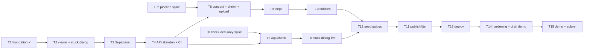

# Showhow Plan and Tasks

**Updated:** 2026-10-30 (reordered after red-team review) · **Deadline:** 2026-11-04 21:00 ET, target submit ~15:00 ET
Spec: [`PRD.md`](PRD.md) · Architecture: [`ARCHITECTURE.md`](ARCHITECTURE.md)

A task is `[x]` only when its **Verify** step has passed and is noted in `HACKATHON-LOG.md`. Each task is one `/build` run: test first where there's logic, then lint, typecheck, test and build, then commit.

**Talha's inputs (needed by the day shown):**
- [ ] D1: Meta API key with the $150 credits claimed, in `apps/showhow/.env.local` (never pasted in chat). Meta documents no spend-limit control, so the app's own caps are the guaranteed limit.
- [ ] D1: post the hosting/terms question in Discord #office-hours (don't wait for 11-02).
- [ ] D1: pick 3–4 candidate seed tasks (no food) and take the staged photo set for T0: 5 right, 5 wrong, 2 blurry per task.
- [ ] D2: free Supabase project + Vercel account.
- [ ] D3: film the chosen seed videos (≤3 min, narrated, distinct parts).

## Dependency graph

## Day 0–1: 2026-10-30 → 2026-10-31. Prove the riskiest assumption first

- [x] **T1 Foundation.** Deps, lockfile, vitest, `.env.example`; lint, typecheck, test and build green.
- [ ] **T0 Check-accuracy spike (highest risk).** `scripts/spike-check.ts` runs Muse Spark (2 images, `json_schema` verdict with `sam_noun`) then SAM 3.1 (`include_confidence`) on Talha's staged photo set. **Verify:**
  - log accuracy (right → match, wrong → differs with a box on the right part, blurry → unclear), match counts and latency per task;
  - pick only the seed tasks that pass.
- [ ] **T0b Pipeline spike.** On a real phone clip in desktop Chrome:
  - Mediabunny shrink, timed; output ≤48 MB;
  - WAV → Voice Transcribe `ENDPOINTING` turns;
  - Spark with `video_url` + numbered turns → steps by turn index.
  - **Verify:** times, sizes and step quality logged; PRD §11 unknowns updated.
- [x] **T2 Viewer + stuck dialog (fixture mode).** Port the prototype's guide viewer (segment loop, box overlay, steps, timeline) and stuck dialog (preview → working → verdict). Gallery and create screens stay minimal. **Verify:** component tests (no send before approval, new photo needs re-approval, unclear draws no outline); manual check at 390 px and 1366 px.

## Day 2: 2026-11-01. Data + creator pipeline on desktop Chrome

- [ ] **T3 Supabase.** `supabase/schema.sql` (tables, RLS, public buckets with UUID paths) applied; viewer reads published guides through the anon key. **Verify:** RLS test (anon can't read drafts or write); the viewer renders a DB guide.
- [x] **T4 API skeleton + CI.** *(Done 2026-10-31. Every CI step passes locally; the first GitHub run happens on the next push.)*
  - Vercel `/api` shared handler: zod body, access code, usage caps, redacted logs.
  - GitHub Actions: lint, typecheck, test, build, gitleaks, bundle secret scan.
  - **Verify:** unit tests for the access code, caps and redaction; CI green; a seeded fake canary is caught.
- [ ] **T8 Creator consent + shrink + upload.** Consent screen, `canEncode` check, Mediabunny shrink with progress, signed uploads. **Verify:** sizing unit test; a real phone file lands in Storage at ≤48 MB.
- [ ] **T9 Steps.** Transcribe turns → Spark steps by turn index → `validateSteps` → saved. **Verify:** validation unit tests; one real video gives sensible steps.

## Day 3: 2026-11-02. The learner check + seeds

- [ ] **T10 Outlines.** Midpoint keyframes uploaded → SAM per step with `sam_noun` → best box or null (ambiguity rule). **Verify:** gate unit tests; boxes land on the right parts for one real guide.
- [ ] **T5 `/api/check`.** Spark verdict (zod) → SAM box on the learner photo → gate. **Verify:** unit tests (match, differs+box, differs ambiguous, unclear, malformed, timeout); one live call logged.
- [ ] **T6 Stuck dialog live.** Resize to ≤1600 px, real preview, `/api/check`, box rendering, error states. **Verify:** staged right/wrong/blurry photos on phone and desktop give the expected verdicts, logged.
- [ ] **T12 Seed guides.** Talha films; we build them through the real pipeline. **Verify:** each guide checked by hand; outline accuracy (≥70% of steps) measured and logged.

## Day 4: 2026-11-03. Ship a live build + draft demo

- [ ] **T11 Publish lite.** Rename steps, publish, share link, gallery list (search/filters only if time allows). **Verify:** an end-to-end creator run on desktop Chrome, timed and logged.
- [ ] **T13 Deploy.** Vercel production with env vars, access codes, daily caps; Supabase keep-alive through 2026-11-09. *(Ask Talha first.)* **Verify:** T6 and T11 checks pass on the deployed build; no secret in the client bundle.
- [ ] **T14 Hardening + draft demo.**
  - Failure states (ARCHITECTURE §6), 18+ checkbox, privacy note, accessibility pass.
  - Record a draft demo.
  - **Verify:** failure drill logged; red-team review of the deployed build and draft video.

## Day 5: 2026-11-04. Final demo and submit by ~15:00 ET (hard deadline 21:00 ET)

- [ ] **T15 Demo + submission.**
  - Final 3-minute video: problem → creator upload (desktop Chrome, ≤3 min clip) → guide → "I'm stuck" catches a mistake → vision.
  - README listing what was built during 2026-10-27 to 2026-11-04.
  - Git history scan before the repo goes public.
  - Submit and post on X.
  - *(Each public step needs Talha's go-ahead.)* **Verify:** the demo claims match the deployed build; the submission is confirmed.

## Stretch (only if everything above is green)

- [ ] **T16 Read step aloud (Wit.ai TTS).** At publish, the server synthesizes each step's instruction once (`POST api.wit.ai/synthesize`, a clean voice such as Rebecca) and stores a ~50 KB MP3 per step in Storage. The viewer gets a "Read aloud" button with pause/stop. Text only, so no user media goes to Wit. **Verify:** audio plays for every step of a seed guide; a missing MP3 hides the button.
- [ ] **T17 Voice guides (first after the core loop; replaces T7 as top stretch).**
  - [x] (a) Consistency spike (2026-10-31): base image + one edit per step keeps the object identical; a highlight edit adds an orange focus circle on the key part. Logged.
  - (b) `src/lib/safety.ts` blocked-topics list + Spark review schema, test-first (harmful, gibberish, incomplete, valid, invalid JSON → blocked).
  - (c) `POST /api/voice-guides` (WAV ≤2 min in one request, gates, steps, draft) and `/images`.
  - (d) Create flow: "Talk it through" option, record/upload, consent, style picker with the 6 stored samples (`public/styles/`), progress, blocked-reason screen, review, publish.
  - (e) Viewer: illustration in place of the clip, "Illustration by AI" label, no "I'm stuck" button.
  - **Verify:** one real voice guide published end to end; a staged harmful and a gibberish recording are both blocked with nothing in the DB or Storage.
- [ ] **T7 Where am I?** Learner photo + step keyframes → `{step, reason}` → jump to step.

## Cut order if behind

1. Where am I? (T7, stretch only)
2. Voice guides (T17) if the core loop isn't solid by end of Day 3
3. Gallery search and filters
4. Creating guides on a phone (desktop Chrome is the supported creator path)
5. Step editing in review (publish as generated)
6. Fourth seed guide

Never cut: real model calls, consent screens, honest failure states, a deployed live build.
