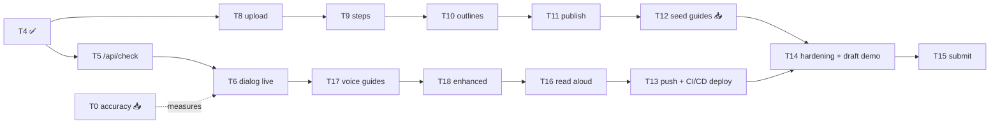

# Showhow Plan and Tasks

**Updated:** 2026-11-01 · **Deadline:** 2026-11-04 21:00 ET (target submit ~15:00 ET)
Spec: [`PRD.md`](PRD.md) · Architecture: [`ARCHITECTURE.md`](ARCHITECTURE.md) · Decisions: [`DECISIONS.md`](DECISIONS.md)

**Rules.** A task is `[x]` only when its **Verify** step has passed and is logged in `HACKATHON-LOG.md`. Each task is one `/build` run: test first where there's logic, then lint, typecheck, test and build, then commit. **Docs are updated in the same commit as the change** (PRD, ARCHITECTURE, TASKS, DECISIONS as relevant).

## Status at a glance

| Done ✅ | In progress 🔨 | Next ⏭ | Waiting on Talha 📥 |
|---|---|---|---|
| T1 foundation · T2 UI (fixtures) · T3 database + RLS · T4 API + CI · T17a image-consistency spike · live checks of all Meta APIs + Wit.ai · end-to-end doc consistency review | T8 upload | T9 → T10 → T11 → T5 (all local) | Videos (air purifier first) · staged photos · Vercel account (Day 4) |

## Talha's inputs

- [x] Meta API key in `.env.local` (2026-10-30)
- [x] Supabase project + keys (2026-10-31); `VITE_SUPABASE_URL` still ends in `/rest/v1/` (code tolerates it; please trim)
- [x] Wit.ai token (2026-10-30)
- [ ] **Air purifier video** (1–3 min, narrated, landscape preferred): unlocks T0b and the first real guide
- [ ] **Staged photos** for 1–2 steps per video (2 right, 2 wrong, 1 blurry): unlocks T0
- [ ] Dishwasher + coffee machine videos (by Day 3)
- [ ] Optional: Discord #office-hours hosting question
- [ ] Vercel account (Day 4, for T13)
- [ ] Videos: all three if possible; otherwise voice guides (audio only) cover the gaps

## Dependency graph

## Done (2026-10-30 → 10-31)

- [x] **T1 Foundation.** Deps, lockfile, vitest, `.env.example`; lint/typecheck/test/build green.
- [x] **T2 Viewer + stuck dialog (fixture mode).** Gallery, guide viewer, stuck dialog with consent tests; 390/1366 px checked.
- [x] **T3 Database.** Schema applied via Management API; RLS 11/11 on the live DB; `kind`, `image_style`, `image_path`, `attempts` columns.
- [x] **T4 API skeleton + CI.** `route()` wrapper, caps (fail closed), dev `/api` bridge, bundle + history secret scans, CI workflow (first GitHub run on next push).
- [x] **T17(a) image-consistency spike** and the 6 style samples in `public/styles/` (logged 2026-10-31).

## Day 2: Sun 2026-11-01. Core loop, all local

- [x] **T8 Creator upload.** *(Server + upload path verified live 2026-11-01. The in-browser shrink of a real phone file is confirmed when Talha uploads the air purifier video, tracked in T0b.)* `/api/guides` (access code, `build` cap, consent + 18+, draft, signed URLs) → Create flow: form + consent → `canShrinkHere` → shrink with progress → direct uploads. **Verify:** `api/guides.test.ts` (401 without code, 400 without consent/adult, 429 on cap, signed URLs returned); a real phone file lands in Storage at ≤48 MB.
- [x] **T9 Steps.** *(Done 2026-11-01: 7 route tests; live run 28.6 s with Spark reading the Supabase URL. Real-video step quality is checked in T0b.)* `/api/steps`: status gate (`draft`/`failed`, `attempts < 3`) → download WAV → Transcribe → Spark (public `video_url` + turns) → `validateSteps` → save → `ready` → return signed upload URLs for `{idx}.jpg`; WAV deleted in `finally`. Create flow shows the steps. **Verify:** route test with mocked Meta/DB (valid; invalid output → `failed`; <2 turns; gate refuses a 4th run; WAV deleted on failure); one real video gives sensible steps; **Spark fetching the Supabase public URL confirmed and logged** (fallback: data URL ≤ ~20 MB or Files API).
- [x] **T10 Outlines.** *(Done 2026-11-01: 4 route tests + live pipeline run. Box accuracy on real footage is measured in T12.)* Browser captures midpoint keyframes → uploads via T9's URLs → `/api/outlines` → SAM (`sam_noun`) → `bestOutline` → save. **Verify:** boxes on the right parts for the first real guide; no-match steps show none.
- [x] **T11 Publish.** *(Done 2026-11-01: 3 route tests; live end to end in ~36 s; anon can read it only after publish; gallery and viewer read from Supabase.)* Review (rename steps/instructions) → `/api/publish` → share link; gallery + viewer read published guides from Supabase (fixtures only when no DB is configured). **Verify:** end-to-end creator run on desktop Chrome, timed and logged.
- [x] **T5 `/api/check`** *(Done 2026-11-01: 9 route tests; live calls returned schema-valid verdicts in 5–8 s. Accuracy is measured on real footage in T0.)* (built test-first now; not blocked on photos). Real keyframe vs learner photo (base64 data URL) → Spark verdict (`/v1/responses`) → SAM if `differs` → gate; `check` caps. **Verify:** unit tests (match, differs + box, ambiguous, unclear, malformed, timeout, cap hit).
## Day 3: Mon 2026-11-02. Real footage + learner check + voice guides

- [x] **T6 Stuck dialog live.** *(Built 2026-11-01: real `/api/check` via on-device resize, 18+ once per session, server messages shown; 2 new component tests. Phone/desktop run with staged photos pending T0.)* Photo resize ≤1600 px, real preview, `/api/check`, box on the learner's photo, error states, 18+ on first check. **Verify:** staged right/wrong/blurry photos on phone and desktop give the expected verdicts.
- [ ] **T0 Check accuracy** *(needs staged photos)*. `scripts/spike-check.ts`. **Verify:** right → match, wrong → differs with the box on the right part, blurry → unclear; accuracy + latency logged; only passing tasks appear in the demo.
- [ ] **T0b Real-video pipeline** *(needs the air purifier video)*. Browser shrink time on the real file + step quality. **Verify:** logged; PRD §11 updated.
- [ ] **T12 Seed guides** *(needs the 3 videos)*. Air purifier, dishwasher, coffee machine through the real pipeline. **Verify:** each checked by hand; outline accuracy (≥70% of steps) measured and logged.
- [ ] **T17 Voice guides** (starts once T6 passes locally).
  - [ ] (b) `src/lib/safety.ts` blocked-topics list + Spark review schema, test-first (harmful, gibberish, incomplete, valid, invalid JSON → blocked).
  - [ ] (c) `/api/voice-guides` (raw `audio/wav` body ≤2 min, gates, steps, draft only after passing) and `/api/voice-images` (base → per-step edit → highlight edit), both status-gated.
  - [ ] (d) Create flow: "Talk it through", record/upload, consent, style picker (samples ready), blocked-reason screen, review + regenerate, publish.
  - [ ] (e) Viewer: illustration + "Illustration by AI", "Show part" switches plain/highlighted, no "I'm stuck".
  - **Verify:** one real voice guide published end to end; a staged harmful and a gibberish recording are blocked with nothing in the DB or Storage.

## Day 4: Tue 2026-11-03. Extras + hardening, everything complete locally, then push + deploy

- [ ] **T18 AI-enhanced step images** *(committed scope, 2026-11-01)*. `/api/enhance` (status-gated): keyframe → Muse Image edit → highlight edit → `{idx}-ai.jpg` / `-ai-focus.jpg`; the creator approves each at publish (rejected → `image_path` null). Viewer: "Enhanced by AI" + "View original frame". **Verify:** on a dim/blurry seed clip the enhanced image shows the same parts (by eye, logged); unit test that `/api/check` only reads `keyframe_path`.
- [ ] **T16 Read aloud (Wit.ai)** *(committed scope)*. `/api/tts` at publish → MP3 per step → "Read aloud" with pause/stop. **Verify:** plays on every step of a seed guide; no MP3 hides the button.
- [ ] **T13 Push + CI/CD deploy** *(after everything works locally; needs Talha's OK + Vercel account)*.
  - Local production rehearsal first: `npm run build` + scans, and every flow run once against the real DB/Meta through the dev bridge.
  - `.github/workflows/deploy.yml`: after CI passes on `main`, deploy to Vercel with the Vercel CLI (pinned version; `VERCEL_TOKEN`/`VERCEL_ORG_ID`/`VERCEL_PROJECT_ID` as GitHub secrets, used only in this job; no secrets in PR runs). A manual `vercel deploy --prod` from local is the fallback.
  - Vercel env vars (server-only secrets incl. `IP_SALT`), `vercel.json` with `maxDuration` for long routes, access codes; Supabase keep-alive through 2026-11-09.
  - Write the dated public-exposure decision before sharing the URL.
  - **Verify:** CI green on GitHub; the deploy job succeeds; every flow (video guide, check, voice guide, enhanced, read aloud) works on the live URL; bundle scan clean.
- [ ] **T14 Hardening + draft demo** (on the live URL). Every failure state in ARCHITECTURE §12, `scripts/cleanup-drafts.ts` (unpublished > 24 h), privacy note, accessibility pass (keyboard, focus, labels, contrast), phone check. Record a draft demo. **Verify:** failure drill logged; red-team review of the live build and draft video.

## Day 5: Wed 2026-11-04 (submit by ~15:00 ET; hard deadline 21:00 ET)

- [ ] **T15 Demo + submission** *(each public step needs Talha's go-ahead)*. Final 3-minute video: problem → video guide from a phone clip → "I'm stuck" catches a mistake → voice guide with illustrations → vision (Ray-Ban Meta live help). README listing work done 2026-10-27 → 11-04. Git history scan, repo public, submit, post on X. **Verify:** every demo claim matches the live build; submission confirmed.

## Stretch (only if everything above is green)

- [ ] **T7 Where am I?** Learner photo + step keyframes → `{step, reason}` → jump to step. **Verify:** unit test for the parser; on one seed guide a mid-task photo returns the right step (logged).

## Cut order if behind

1. T7 Where am I?
2. T16 Read aloud
3. T18 AI-enhanced images
4. T17 voice guides (if the core loop isn't solid by end of Day 3)
5. Gallery search/filters
6. Step editing in review (publish as generated)
7. Third seed guide

**Never cut:** real model calls, consent screens, honest failure states, the "I'm stuck" check on video guides, a deployed live build.
