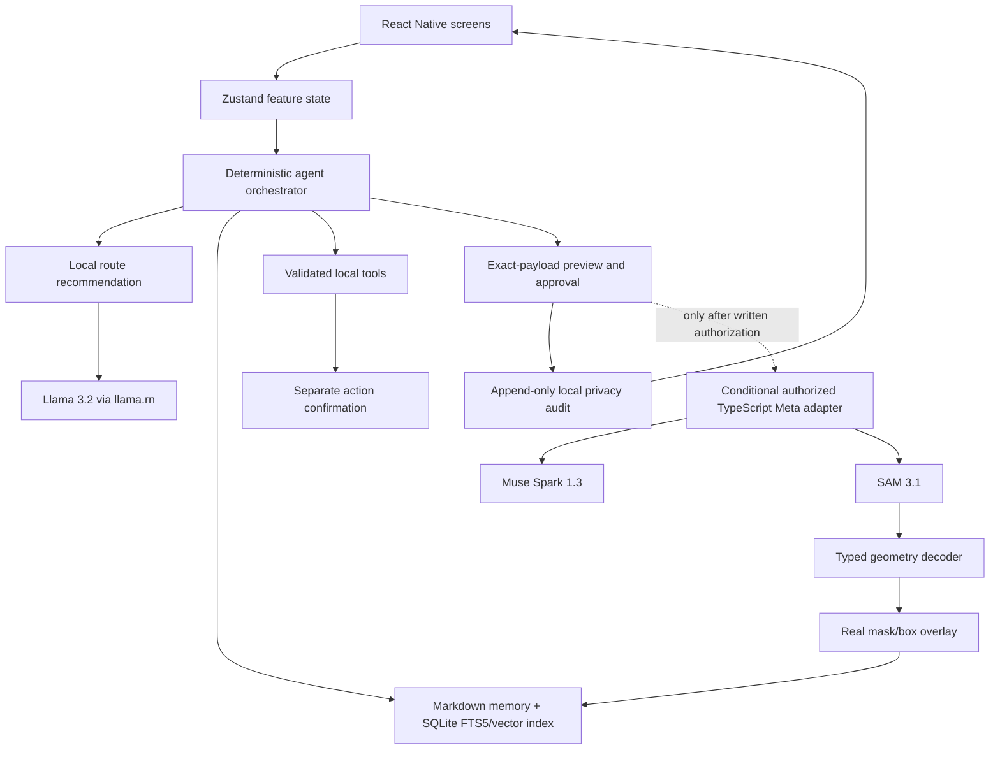

# Vault — Product Requirements Document

> **Hackathon status (2026-10-29): superseded as the active event entry.** This document remains the product specification for the separate Vault mobile product. The hackathon project is now Goodfix Web under [`apps/goodfix-web/PRD.md`](apps/goodfix-web/PRD.md). Keep this history; do not use this Expo/React Native plan as the Goodfix implementation brief.

**Version:** 1.0  
**Status:** Hackathon MVP specification  
**Last updated:** 2026-10-28  
**Target:** Meta Global AI Developer Hackathon, Indie Developer Track  
**Submission deadline:** 2026-11-04 21:00 ET  
**Platform decision:** Expo / React Native for Android and iOS

## 1. Product summary

Vault is a personal mobile agent that keeps useful context on the phone, asks before sending selected information to an online model, can locate an object in a user-selected photo, and can recall the saved sighting later—even when the phone is offline.

The product is the continuity loop, not a model gallery:

> **Capture privately → remember locally → ask for help when useful → see what leaves → confirm → save a grounded result locally → recall it offline.**

Vault is for ordinary adults who want a useful assistant without learning prompts, model names, API endpoints, or agent terminology. It is 18+ and is not a medical, therapy, diagnostic, or crisis-support product.

### Product promise

- **Local is the default.** Notes, memory, recall, simple routing, and supported device actions work without a network connection.
- **Online is optional and visible.** Turning on Meta models makes them available; it does not authorize any particular request. Every cloud request needs its own exact-payload preview and affirmative approval.
- **The app tells the truth.** Every answer identifies whether it ran on-device or used a named Meta model. A failed or empty scan is never presented as a successful find.
- **The user owns their memory.** The source of truth stays in local, editable files; SQLite indexes support search and recall.

## 2. Product goals and non-goals

### Goals for the hackathon MVP

1. Deliver the existing local capture, memory, and recall loop as the reliable baseline; add Muse Spark and SAM 3.1 as conditional live-model beats only after account authorization and device smoke tests pass.
2. Make the privacy boundary legible and enforce it in the app flow, not only in marketing copy.
3. Show real model output and a real mask/box overlay on a physical Android or iOS device.
4. Keep the existing React Native agent, memory, action-confirmation, and privacy architecture as the implementation base.
5. Produce honest Android and iOS build artifacts where the available device/signing toolchain permits.

### Non-goals for the hackathon MVP

- Implementing all Stitch screens or claiming feature parity with the full product map.
- Building a general autonomous agent, public skill marketplace, integrations platform, web browser, MCP server manager, or model-aggregator business.
- Video tracking, continuous camera access, background listening, wake-word detection, multi-image gallery scanning, or persistent camera upload.
- Accounts, cloud sync, team sharing, payment plans, or user analytics.
- Automatic provider fallback that silently sends personal data to another model.
- Adding Muse Image generation/editing to the hackathon build.

The Indie track's public description emphasizes creativity, technical ambition, and whether the project works. This PRD optimizes for one coherent, working product loop rather than breadth; it does not assume unpublished scoring weights. [Official hackathon page](https://dev.meta.ai/events/global-hackathon)

## 3. Users and primary jobs

### Primary user

A non-technical adult who wants to remember personal details and get help with everyday planning, but does not want to manage prompts, model setup, privacy settings on every screen, or raw provider credentials.

### Jobs to be done

- “Remember this, and let me find it later.”
- “Help me plan from the notes I choose to share.”
- “Show me where this object is in this photo, and remember where I last saw it.”
- “Keep basic capture and recall working when I have no signal.”
- “Let me see and remove what Vault remembers, and see what I approved sending.”

## 4. MVP scope and model policy

### P0 — Required product foundation

#### A. Local assistant and small offline model

- Treat **Meta Llama 3.2 1B Instruct** as a candidate for an offline Meta SLM; allow **Llama 3.2 3B Instruct** only if the selected device passes cold-load, memory, heat, and response-time gates. This is an evidence-gated spike, not a claim that the current app already runs Llama.
- Run the selected quantized, llama.cpp-compatible model through the existing `llama.rn` inference boundary. Model weights are downloaded only after a clear user action, with size/progress/cancel state; they are not bundled in the app.
- The model supports private text capture, ordinary local recall, and simple everyday conversation. Deterministic routing remains the fallback for supported note/reminder tasks.
- Offline behavior must not imply offline image understanding. The text SLM does not replace SAM; a SAM scan requires connectivity and explicit approval.
- Existing **Qwen2.5 3B** code remains a development/compatibility fallback. The app and demo must name the model that actually ran. Do not claim Llama until that build has loaded Llama on a real device.

Meta identifies Llama 3.2 1B and 3B as text models designed for mobile/edge use. **Muse Glimmer is not the phone SLM for this MVP:** Meta documents it as a 30B model, with a quantized GGUF around 17 GB. Muse Spark Open is also far larger. [Llama 3.2](https://ai.meta.com/blog/llama-3-2-connect-2024-vision-edge-mobile-devices/), [Muse Glimmer model details](https://dev.meta.ai/docs/muse-glimmer), [Muse Glimmer artifacts](https://dev.meta.ai/docs/muse-glimmer/get-the-model)

#### B. Local memory and safe device actions

- Store notes and confirmed object sightings as local Markdown files; use SQLite FTS5 and the existing vector index for local search/recall.
- A saved sighting contains the user-confirmed object label, time, human-readable location derived from the real mask/box, and optional local image reference. The user can inspect, edit, or delete it.
- Existing reminder/calendar tools may be used only when relevant to the user's task. Model output is a proposal; schemas/validators check it; the user confirms any OS side effect in a separate confirmation step.
- Airplane-mode acceptance: save a note, recall a note, and recall a previously saved object sighting with no network request.

#### C. Muse Spark online reasoning

**Conditional demo beat:** this is not a release blocker unless the participant's account and deployment path are explicitly authorized by Meta and the real-device request flow passes its smoke test. Without that authorization, the online switch remains unavailable in the hackathon build and the demo uses the local baseline.

- Use **Muse Spark 1.3**, model ID `muse-spark-1.3`, for one bounded task that benefits from stronger multi-step reasoning, such as making a plan from selected memory excerpts.
- Send only the user's current request and the small set of memory excerpts that the user reviewed and selected. Do not upload the whole memory database, chat history, or profile by default.
- The on-device router may recommend “Use Muse Spark,” but cannot call it. The user must see and approve the exact payload, model, destination, and whether a Vault-operated relay is involved.
- Validate returned structure and content before presenting it. Spark may propose actions; it cannot execute reminders/calendar changes.
- Use the Standard model ID, not a Contributor variant, for personal context. Standard mode does not use request content to train Meta models, but that is **not** a zero-retention promise. Meta's terms describe retention for service, legal, safety, and other stated needs. [Model catalog](https://dev.meta.ai/docs/models), [Meta Model API terms](https://dev.meta.ai/legal/terms-of-service)

#### D. SAM 3.1 still-photo scanner and visual memory

**Conditional demo beat:** SAM is enabled only after the same authorization gate plus a real-device end-to-end parser and overlay smoke test. If either gate fails, do not imply the scanner is connected.

- Add a dedicated **“Find an object in this photo”** flow. The live Stitch inventory fetched for this PRD contains no dedicated scanner screen; use the existing camera/attachment and result visual language, then add this missing screen to the design backlog.
- Capture one still image or choose one photo, enter/select a short noun phrase (for example “keys”), and show the exact photo and phrase in the consent preview.
- Call **SAM 3.1**, model ID `sam-3.1`, through Meta Model API `POST https://api.meta.ai/v1/responses`. SAM returns segmentation geometry (boxes/masks), not a natural-language scene explanation. Decode the documented response and render its actual box/mask over the same image.
- Derive simple language such as “upper-left area of this photo” only from returned geometry and the image dimensions. The answer means “last seen in this photo,” not a guarantee about the object's current physical location.
- Ask before saving the sighting. Save only the user-confirmed result to local memory. Keep the original photo local unless the user explicitly approves sending that photo for another task.
- If no object is found, geometry cannot be decoded, or the overlay does not align, do not save a location. Offer a clearer photo, a more specific object phrase, a user-tapped point/box retry, or manual note entry.

Meta documents SAM 3.1 as a geometry-producing image/video segmentation model on the Responses API; its stream uses special-token text and must be parsed. The documented image ceilings (50 MB inline; 1 GiB through Files API) are not product targets. Responses background requests have a 1 MiB body limit, so do not default to background mode for inline image payloads. Resize/compress one photo to a measured practical budget, reject oversized images locally, and never silently switch upload methods. Require a tested geometry decoder and native React Native overlay with EXIF rotation and coordinate mapping verified on both platforms. Noun-phrase segmentation can return multiple matches; blank output is a valid no-match. [SAM media segmentation](https://dev.meta.ai/docs/media-segmentation), [SAM overview](https://dev.meta.ai/docs/sam/overview), [SAM SDKs and parser](https://dev.meta.ai/docs/sdks), [image input limits](https://dev.meta.ai/docs/image-understanding), [Responses API](https://dev.meta.ai/docs/protocols/responses)

#### E. Privacy mode, consent, and audit

- Add an **Online Meta models** setting, off by default. It controls availability only; it is not a blanket consent to transmit data.
- Before every online operation, show: operation purpose; exact image/text/excerpts; model name; that data leaves this phone; destination (Meta, plus Vault relay if used); applicable data-use/retention mode; Approve and Cancel.
- Send a single stateless request containing only the approved payload; do not attach prior remote conversation IDs or server-side history by default. A `store:false` request option, if supported, is not a substitute for the provider's published retention terms.
- Cancel before dispatch means no request starts. After dispatch, **Stop waiting** only stops the local wait and ignores late results; it cannot promise provider cancellation or undo a transfer. If dispatch status is ambiguous, audit the request as sent/unknown. A changed image, prompt, memory selection, or destination requires a new preview.
- Record a local append-only audit event with request ID, timestamp, selected model, categories/byte counts, consent result, destination, and outcome. Never put API keys, image bytes, full memory text, or sensitive prompts in logs.
- Show a truthful per-message processing label: **On this phone**, **Sent to Meta after approval**, or **Could not complete**. Never leave a persistent “Private · On-device” status on a cloud-result screen.
- The privacy dashboard must calculate from real local audit events. Never render fictional counts or “nothing left” after an approved cloud call.

### Explicitly cut from the hackathon build

- Muse Image 1.0, image generation/editing, extra provider integrations, and broad model galleries. They add another model path, consent surface, and visual QA burden without proving the core continuity loop. Keep model switching to the local model and the two conditional Meta model actions: Muse Spark and SAM.

### Later — represented by the full Stitch design map, not hackathon acceptance

The older screens include OpenAI/GPT-4o, Anthropic/Claude, OpenRouter, Nous, custom providers, MCP, Telegram, Spotify, Home Assistant, skills/marketplace, automations, web search, advanced plugin controls, wake word, and usage dashboards. These are **not active MVP integrations**. Keep them hidden or clearly marked “not available yet”; never show a live switch that silently routes to an unimplemented service. Revisit after the core product and each provider's authentication, consent, and privacy handling are separately verified.

### Scope cut rule

If a gate fails, cut in this order: Muse Spark; SAM camera beat; external provider screens; advanced settings; secondary voice polish. Preserve local capture → local memory → offline recall. Do not cut consent, local audit, or truthful failure states. A cloud model beat is included only when its legal, credential, and device gates pass; otherwise it is explicitly out of scope.

## 5. Definitive technology stack and architecture

### Client

- **Expo SDK 57 / React Native 0.86 / React 19 / TypeScript 6** — continue the existing cross-platform app; Android and iOS builds come from this codebase.
- **React Navigation 7**, **Zustand 5**, and the current feature boundaries in `src/agent`, `src/memory`, `src/privacy`, `src/inference`, `src/tools`, and `src/ui`.
- **On-device inference:** `llama.rn` / llama.cpp with a measured Llama 3.2 1B or 3B artifact. The current Qwen engine remains a compatibility fallback until Llama passes device gates.
- **Embeddings and retrieval:** existing Qwen3-Embedding-0.6B with SQLite FTS5/sqlite-vec; keyword search remains the fallback when the embedding runtime is unavailable.
- **Local persistence:** `expo-sqlite` with FTS5/sqlite-vec for indexes; Markdown files in app-private storage remain the human-readable source of truth; `expo-file-system` for model and local photo files; `expo-secure-store` only for secrets explicitly approved for local storage.
- **Device services:** existing `expo-calendar` and `expo-notifications`; add the Expo camera/photo-picker capability required for the still-image scan. Request camera/photos/notification permissions at the moment the user invokes those features, not all during onboarding.
- **UI system:** follow the Stitch mobile design system—warm paper `#FAF9F6`, deep teal `#0F766E`, Plus Jakarta Sans headings, Inter body text, generous spacing, accessible type, calm language. Replace inaccurate “nothing leaves”/“end-to-end encrypted” claims.

The precise Expo SDK 57 dependency versions and current native build environment must be checked before application code changes, per `AGENTS.md`. Before distributing Llama weights, verify the selected artifact's license and include required notices.

### Meta API service boundary

- **Mobile app never contains an app-owned/shared Meta API key.** Meta's current authentication guidance says mobile/browser keys are visible to users. A Vault-operated relay is only a proposed option, not an approved architecture.
- Conditional adapter proposal: if Meta gives written authorization for this Integrated Product and relay arrangement, use a minimal **Node.js 22 + TypeScript + Fastify** HTTPS service on **Railway**, with the Meta key stored only in Railway secrets; model allowlist limited to approved Meta IDs; request-size validation; rate limiting; no persistent database; and request-body/credential redaction from logs. Do not implement or deploy it before the authorization gate passes.
- The app must disclose that an approved request passes through the Vault service and Meta. Do not market the cloud path as “device only,” “never stored,” or “end-to-end encrypted.” Use the exact data/retention notice approved for the live account.
- **Hard go/no-go gate:** Meta's current terms separately restrict providing access through a gateway/proxy absent express written authorization. Treat a Vault relay as prohibited until that authorization is obtained and applicable account terms are confirmed. If unclear or unavailable, disable online model calls for this build; do not route around this through a client-embedded shared key. [Meta authentication and key safety](https://dev.meta.ai/docs/authentication), [Meta API terms](https://dev.meta.ai/legal/terms-of-service)
- Before any integrated API use or distribution, provide an accessible privacy policy describing collection, use, processing, retention, and sharing accurately; include an 18+ age attestation and do not target minors. These are release gates, not copy-only tasks.
- Only make documented Meta requests over TLS using `https://api.meta.ai/v1`; use the Responses API for Muse Spark and SAM. Do not copy the older wireframe's generic OpenAI/Anthropic/OpenRouter endpoint assumptions into the Meta adapter.

### System map

### Routing invariants

1. Local-first router chooses a recommendation, never an unapproved network destination.
2. If online Meta models are disabled, the network adapter is unreachable from the turn path.
3. If online is enabled, a candidate cloud turn pauses for the request-specific preview and consent. No remembered “always allow cloud” setting bypasses this.
4. A response from any online model is untrusted input: parse, validate, and constrain it before display or tool use.
5. Changing from Muse Spark to SAM or another provider is a new destination and needs its own preview.
6. Model/tool failures do not cause silent cloud failover. Local fallback is allowed only when it can answer honestly with available local context.

## 6. User flow storyboards

### Flow A — First day, no AI terminology

1. **Welcome:** “Your notes stay on this phone. Online help is optional and always asks first.” Buttons: **Get started**, **How privacy works**.
2. **Choose setup:** “Use Vault offline” is the default. Explain that the small on-device model is a one-time download and show actual file size once pinned. The app remains useful for deterministic notes/search while it downloads.
3. **Ask for permissions only when needed:** no blanket permission wall. Camera/photo permission appears when the user taps **Find an object**; reminders permission appears only when they ask to create one.
4. **Home:** simple conversational input, example tasks, one obvious capture/photo affordance, visible processing state. No prompt editor, model jargon, or requirement to paste a key.

### Flow B — Save and recall privately

1. User types or dictates: “Remember that I put the spare key in the blue desk drawer.”
2. Vault shows a plain confirmation of what it will save; user confirms or edits.
3. Save as local Markdown and update FTS/vector indexes. Show **On this phone**.
4. User asks “Where is the spare key?” Vault retrieves the saved fact locally, cites the memory/date in plain language, and offers **View memory** / **Correct it**.
5. In airplane mode, repeat the recall. If the local model is unavailable, use deterministic/keyword recall and state the limitation; never silently call cloud.

### Flow C — Ask Muse Spark to plan from selected memories

1. User asks: “Help me plan tomorrow morning around my 9 a.m. meeting.”
2. Vault searches locally and suggests the few relevant notes. The user can remove any excerpt.
3. If Online Meta models are off, Vault offers **Enable for this request** and explains that data will leave the phone.
4. This beat is shown only after written-authorization and device gates pass. Preview shows the actual prompt, exact excerpts, **Muse Spark 1.3**, the authorized destination path, and the applicable data-use notice. Buttons: **Send this once** / **Keep it on this phone**.
5. After approval, show a visible streaming/progress state. Label the answer **Muse Spark · Meta**.
6. If the result proposes a reminder/event, show the existing action-confirmation sheet with the exact action. Nothing changes on the device until the user separately confirms.
7. Audit the approval/result metadata locally. Do not store full sent content in the audit.

### Flow D — Scan an object and remember the sighting

1. User taps **Find an object in a photo**. Vault requests camera/photo permission at this point only.
2. User takes one still photo or selects one image, then says/types a short object name such as “keys.”
3. This beat is available only after authorization and parser/overlay smoke tests pass. Preview shows the exact photo, phrase, **SAM 3.1**, that this image leaves the phone, and the authorized destination. User approves once or cancels.
4. Show **Finding “keys” in this photo…** with **Stop waiting** and a bounded wait. No hidden camera stream, extra gallery images, or Spark follow-up.
5. Decode SAM's returned geometry and overlay the real mask/box with EXIF-aware coordinate mapping. If multiple instances appear, let the user select one. Phrase the result as “I found them in the upper-left of this photo.”
6. User taps **Remember this spot** and confirms/edit the local note. Save the local sighting; store the photo only according to the user's explicit choice.
7. Later, including in airplane mode, the user asks “Where did I last see my keys?” Vault returns that dated saved sighting. If no sighting is found, say so plainly.

### Flow E — Switch models without making privacy confusing

1. In **Models**, show two clear groups: **Works offline** (the actual installed local model) and **Online Meta models** (Muse Spark and SAM only when enabled by release gates).
2. The Online Meta switch is off by default. Turning it on makes authorized actions available and displays what data can be sent; it never grants standing consent. If authorization is not confirmed, the switch is unavailable with a plain explanation.
3. The old provider entries (GPT-4o, Claude, OpenRouter, Nous, Custom) are hidden or marked future. Do not leave them with active-looking toggles.
4. A persistent status always reflects the current turn: **On this phone** or **Sent to Meta after approval**.

## 7. Functional requirements and acceptance criteria

### Local model and memory

- [ ] A release-like Android and iOS build loads the named Llama 3.2 quant on real target devices without crash/OOM. Record device, model artifact, cold load, time-to-first-token, throughput, memory, and heat.
- [ ] The text capture/recall path works with airplane mode enabled.
- [ ] Local memory can be viewed, edited, and deleted; deleting the source updates/removes its indexes and image reference.
- [ ] No cloud request occurs during app launch, ordinary local capture, or local recall.

### Muse Spark and consent

- [ ] Online switch defaults off on clean install.
- [ ] Online actions remain unavailable until the written authorization gate passes; a live privacy policy and 18+ attestation are present before integrated API use.
- [ ] A request cancelled before dispatch produces zero outbound API request; a request stopped after dispatch is marked sent/unknown and any late response is ignored.
- [ ] The approved request body matches the previewed prompt and exact selected excerpts; no full-memory/profile attachment is implicit.
- [ ] The response is attributed to Muse Spark 1.3; tool/action suggestions pass validators and separate confirmation.
- [ ] Online mode and audit UI never promise the request stayed on-device or was never retained.

### SAM scan

- [ ] One still photo plus one short object phrase produces a real SAM response.
- [ ] A real decoded mask/box overlays the correct pixels on Android and iOS target devices.
- [ ] No geometry, no match, parser failure, or cancelled request creates no saved location.
- [ ] User can save a confirmed sighting and recall it after disabling network/airplane mode.

### Privacy and judge readiness

- [ ] The app displays the current processing tier on each answer and writes a local audit outcome for each consent decision/request.
- [ ] A request interrupted by network loss never turns into an automatic call to another online model.
- [ ] A physical-device demo can complete the whole loop with the same build represented in the submitted recording.
- [ ] No demo claims a model, endpoint, privacy property, or successful output unless that exact build performed it.

## 8. Edge cases and live-demo contingency plan

| Failure | App behavior | Demo response |
|---|---|---|
| Muse/SAM takes too long or client times out | Show progress and elapsed wait. At the rehearsed app deadline (hard cap 30 seconds), show **Stop waiting** and say the result did not arrive. After dispatch this ignores late results; it does not guarantee provider cancellation. Preserve local notes/photo; do not claim a result or silently re-send. | Offer **Retry once** with a fresh preview or **Continue offline**. If still failing, move to the local-memory/offline proof. |
| HTTP 429 rate limit | Honor `Retry-After`, show a readable wait message, and do not rapid-retry. | Continue the local flow while waiting; do not burn the demo window on retries. |
| HTTP 5xx / transient connection error | Use capped exponential backoff with jitter for eligible transient errors; provide a manual retry. Never log request body or API key. | One retry only during the live presentation; then continue locally. |
| HTTP 504 / first-token timeout | Do not blindly retry an unchanged large non-streaming request. Use supported streaming/background behavior where appropriate, or reduce the request only after a fresh preview. | Explain the timeout plainly, move to offline recall, and do not show cached output as live. |
| HTTP 400 | Treat as a request/compatibility defect; do not retry unchanged. Keep local state intact. | Drop the cloud beat and report after demo; avoid live parameter debugging. |
| HTTP 404 / unsupported model or route | Treat as a configuration defect; do not retry unchanged. | Disable the affected model and continue locally. |
| HTTP 413 / image too large | Reject or resize locally; a changed payload requires a fresh preview and approval. | Continue without the scan if the resized image still exceeds the tested budget. |
| HTTP 401/403/402 | Treat as credential, access, or billing failure; do not retry. Keep online feature visibly unavailable; local app stays usable. | Switch to local loop. Do not ask the judge to paste a key or expose a key in a screen share. |
| SAM finds no object / mask decoding or overlay fails | Do not invent coordinates or save a location. Keep the photo local; offer a clearer photo, a narrower phrase, point/box retry, or manual note. | Do not claim “SAM found it.” Use local recall from a sighting saved before the demo, or proceed to the remaining demo beats. |
| Local SLM missing, still downloading, or crashes | Keep deterministic note, keyword search, and supported reminders available. Show download retry/cancel and name the active local fallback accurately. | Use the already-installed tested model; if none is available, do not claim offline AI succeeded. |
| Gateway unavailable or authorization unclear | Disable Meta calls; never bypass the gateway with an embedded shared key. | Demonstrate only the local product loop. A real, clearly labeled recording may be used as a backup if the event permits; never fake a live response. |

Meta's current error guide distinguishes permanent 400/401/404/402 errors from transient 429/5xx/timeouts. It recommends capped backoff for retryable failures and warns that a non-streaming 504 usually should not be retried unchanged. For streaming, handle `response.failed` and `response.incomplete` terminal events and clean up the stream. The 30-second cap above is Vault's **UX limit**, not a Meta service guarantee; tune it during real-device rehearsal. [Meta API error handling](https://dev.meta.ai/docs/error-handling), [Responses API](https://dev.meta.ai/docs/protocols/responses), [retry guide](https://dev.meta.ai/docs/cookbook/error-handling-retry)

### Demo-day preflight

1. Verify the same build hash on the demo phone; charge above 80%; enable Do Not Disturb; check camera permission and free storage.
2. Verify written authorization, Meta account/model access, standard model selection, billing/credits, rate-limit headroom, authorized service health, and internet connectivity without sending personal material. If any gate is unresolved, disable online actions.
3. Run one non-sensitive staged-image SAM smoke call and one synthetic Muse Spark call before judges arrive; confirm mask alignment and latency.
4. Keep a staged desk and object repeatable; clear other photos/notifications from the screen.
5. Keep the app usable in airplane mode and the honest local loop ready. If live service is down, never replace it with fake output.
6. Record a clean backup only from the real build. Label it prerecorded if played; follow event rules for demo fallback.

## 9. Stitch wireframe reconciliation

The live Stitch project **“Vault — Private On-Device AI Agent”** (project ID `12061351565962533710`) returned 63 entries on 2026-10-28: 60 mobile entries representing 54 unique mobile screen titles (six titles have duplicate variants), plus three non-mobile visual assets. The local [`docs/WIREFRAMES.md`](docs/WIREFRAMES.md) has 53 numbered prompts. Use the live Stitch project as visual authority and reconcile the one-screen inventory difference before claiming parity.

The reviewed live designs provide the visual basis for Welcome/privacy onboarding, Chat Home, attachments, action confirmation, Memory/Memory Detail, Model Settings/Downloads, API Keys, Advanced Providers & Routing, Privacy Dashboard, and Activity Audit Log. They are a full-product roadmap, not a hackathon checklist. The live inventory has no dedicated SAM object-scanner screen; add that screen in the same visual system before implementing the camera flow.

### Legacy labels to replace, not carry forward as current integrations

| Existing Stitch label | MVP interpretation |
|---|---|
| Llama 3 (8B), Mistral (7B), Phi-3 Mini | Replace with the real installed Meta Llama 3.2 1B/3B mobile choice; do not claim 8B/7B models are running. |
| GPT-4o, Claude 3.5 Sonnet | Replace the hackathon cloud choice with Muse Spark 1.3; external providers are later scope. |
| OpenAI, Anthropic, OpenRouter, Nous, Custom | Future provider architecture only; hidden/disabled in MVP until each provider's auth, privacy, routing, and consent behavior is implemented. |
| “Nothing leaves your device,” “No cloud,” “End-to-end encrypted” | Replace with “Local by default. Online requests send the previewed content after you approve.” Never claim encryption/retention guarantees not implemented and verified. |
| General “vision”/“image description” tool | Replace for the hackathon with the bounded SAM 3.1 named-object segmentation flow. SAM returns geometry; it is not a general scene-understanding answer. |

Full design topics such as Skills, Marketplace, Automations, MCP, Integrations, Home Assistant, Spotify, voice/wake-word settings, and advanced providers remain post-MVP roadmap items.

## 10. Risks and release gates

The checked-in app is the starting point, not proof that these MVP beats already work. At PRD creation, the existing local agent uses Qwen2.5 3B and local memory; Meta cloud calls, SAM camera capture/decoder/overlay, and an installed Llama 3.2 artifact are not verified in this app. Keep those claims gated on a real Android/iOS device run. The local loop is the minimum credible build; cloud beats are conditional additions.

| Gate | Pass condition | If it fails |
|---|---|---|
| Meta API/auth/legal | Current account can call the required Standard models; permitted Integrated Product credential/relay path is confirmed; no secret ships in the app. | Keep cloud switches disabled. Do not invent a workaround. |
| Local Llama on device | Same selected model loads and handles the required local loop on real iOS and Android demo targets. | Use deterministic local actions and existing Qwen only as an honestly named fallback; do not claim the Meta local model. |
| SAM geometry | Real response parses and overlay aligns on both demo target builds. | Cut camera beat or allow explicit manual sighting; no simulated mask. |
| Privacy truth | Payload preview matches actual request; audit records outcome; copy matches real Meta terms and relay handling. | Disable cloud integration until corrected. |
| Time/scope | Local baseline stable before attempting conditional cloud beats; no roadmap screens. | Cut optional features using the cut rule in section 4. |

## 11. Source-of-truth and verification rules

- Product/privacy constraints: [`AGENTS.md`](AGENTS.md) and [`docs/archive/DECISIONS.md`](docs/archive/DECISIONS.md).
- Existing implementation: [`docs/ARCHITECTURE.md`](docs/ARCHITECTURE.md), source under `src/`, and [`package.json`](package.json). These describe the current app, not every future requirement in this PRD.
- Design: live Stitch project ID above; local text index: [`docs/WIREFRAMES.md`](docs/WIREFRAMES.md).
- Meta model IDs, API paths, request/response parsing, rate limits, terms, and pricing/access are volatile. Re-check Meta's official documentation and the participant account before coding or presenting a capability.
- Never repeat old playbook claims about $150 credits, endpoint availability, rate limits, model output, or hardware performance as current facts without fresh evidence.
- Hackathon public judging text and dates: [Official event page](https://dev.meta.ai/events/global-hackathon).

### Official Meta references checked 2026-10-28

- [Model catalog and model IDs](https://dev.meta.ai/docs/models)
- [Responses API](https://dev.meta.ai/docs/protocols/responses)
- [SAM overview](https://dev.meta.ai/docs/sam/overview)
- [SAM media segmentation and response geometry](https://dev.meta.ai/docs/media-segmentation)
- [Meta API authentication and key handling](https://dev.meta.ai/docs/authentication)
- [Meta API terms](https://dev.meta.ai/legal/terms-of-service)
- [Meta API error handling](https://dev.meta.ai/docs/error-handling)
- [Standard vs Contributor Services and retention terms](https://dev.meta.ai/legal/terms-of-service)
- [Llama 3.2 mobile/edge models](https://ai.meta.com/blog/llama-3-2-connect-2024-vision-edge-mobile-devices/)
- [Muse Glimmer sizes and runtime artifacts](https://dev.meta.ai/docs/muse-glimmer/get-the-model)
